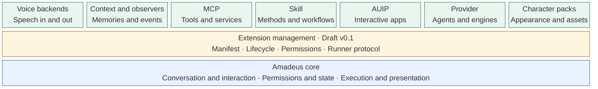

# Amadeus-Extensions

Public design direction and discussion for the Amadeus extension system.

> **Status: Draft specification v0.1**
>
> A first draft of the extension protocol is available for discussion. Unmerged Amadeus experiments implement TTS/MCP/Skill lifecycle and data-only desktop themes; no stable SDK has been released. Interfaces and compatibility guarantees may change until 1.0.

## Why this repository exists

We want developers to extend Amadeus without modifying its core code, and users to install, configure, enable, disable, and uninstall extensions easily.

Our current focus is how extensions fit into Amadeus capability discovery, routing, and runtime management. The v0.1 draft below is a first proposal. Its provisional parts become normative only after real extensions use them.

## Draft specification v0.1

| Document | What it covers |
| --- | --- |
| [Extension Protocol v0.1](spec/extension-protocol-v0.1.md) | Manifest, lifecycle, permissions, Runner protocol, packaging |
| [Voice backends](spec/contracts/voice-v0.md) | TTS backends (provisional) and ASR backends (provisional) |
| [Desktop themes](spec/contracts/theme-v0.md) | Data-only palettes, installed fonts, bounded images and package lifecycle (provisional) |
| [Context sources](spec/contracts/context-source-v0.md) | Reference material such as memories for Main Chat turns (provisional) |
| [Observers](spec/contracts/observer-v0.md) | Projected Host events (provisional) |
| [Manifest schema](schemas/amadeus-extension.v0.schema.json) | JSON Schema for `amadeus-extension.json` |
| [Examples](examples/) | Six manifest examples; the experimental Host supports only its documented subset |

In short:

- An extension is a package with one `amadeus-extension.json`. It never imports Amadeus internals.
- Process contributions run in their own process and Python environment and reach Amadeus only through the protocol. Resource-only packages do not execute code during preparation.
- The first experimental profile rejects all Host capability requests and stores no Grants; broader permission design is provisional.
- Pure frontend packages apply immediately. Packages with backend contributions retain one loaded version until backend restart. Disabling or removing a mixed package closes its frontend contributions immediately while clearly reporting the old backend awaiting shutdown. Runner crash recovery stays inside the proxy.

Agent Skills can be installed once and bound to selected Codex, ACP and Pi
Agents in the experimental Host. Unchanged native sessions resume; changing
the selected Skill revision requires a new session so old instructions cannot
linger unnoticed. Codex/Pi process tests use controlled local models; DeepSeek
Harness additionally has real-model and desktop evidence. ACP defaults to a
portable Skill catalog; explicit `skill_discovery=dsh` enables DSH native
startup discovery. The implementation's accepted subset and limits live in
Amadeus `docs/extension_host_profile_v0.1.md`. The experiment retains identified
upstream stdout and Windows sandbox-environment limitations; these are not
claims of production qualification.

To validate a manifest or a package directory:

```bash
python -m pip install -r requirements-dev.txt
python tools/validate_manifest.py examples/mimo-tts
python -m pytest
```

## Current design direction

### Capability discovery within a prompt budget

- Limit the prompt overhead introduced by extensions, without loading every extension's full instructions and tool definitions on every conversation turn.
- Use concise capability descriptions for routing, then load relevant contracts, instructions, and context when execution requires them.
- Account for both individual extension budgets and the total candidate budget while keeping installed capabilities discoverable and selectable.

### Integration with existing routing

- Build on existing routing and execution boundaries so extensions can register, deactivate, and unregister consistently.
- Keep routing-visible capabilities aligned with what the current execution entry point can actually run.
- Allow integrations without requiring each extension to modify core routing logic or append its own system prompt instructions.

### A manageable lifecycle

- Define the behavior of installation, configuration, enablement, disablement, upgrades, and removal.
- Stop accepting new calls after deactivation, with explicit handling for existing tasks, connections, and background resources.
- Preserve necessary history and define clear rules for handling user data.

### Controlled runtime impact

- Contain the effects of extension dependencies, state, and failures on the core runtime and other extensions.
- Keep the Host responsible for identity, permissions, execution authority, and durable facts.
- Installing or enabling an extension does not itself authorize a specific action.

These are design goals. The guarantees provided will be documented as runtime mechanisms are implemented and validated.

## Relationship to Amadeus

The [Amadeus project](https://github.com/Code-Amadeus/Amadeus) already includes foundations such as Providers, MCP, Skills, AUIP, and CapabilityCatalog.

These mechanisms cover execution capabilities, external tools, workflows, application collaboration, and capability management and discovery. Future extension work will build on these boundaries, exploring shared distribution and management while preserving the responsibilities of each native protocol.

Existing internal implementations are not stable third-party extension interfaces. This repository provides the experimental [standalone TTS SDK](sdk/python/README.md); installation and authority remain in the Host. No stable SDK release is claimed.

## Extension paths

The table shows where each developer goal stands in the v0.1 draft. It is not a release schedule.

| Developer goal | Suggested integration | v0.1 draft |
| --- | --- | --- |
| Synthesize or recognize speech | Voice backend | TTS and ASR provisional |
| Connect services, query data, or provide tools | MCP server | Provisional, declarative |
| Provide specialist methods, workflows, or templates | Skill | Provisional, declarative |
| Give the character reference context, such as memories | Context source | Provisional |
| React to conversations and Work progress | Observer | Provisional |
| Build interactive apps that collaborate with the character | AUIP | Reserved for a later version |
| Connect a new agent or execution engine | Provider adapter | Reserved; ACP agents can already be configured in Amadeus |
| Customize character appearance, scenes, or assets | Existing character-pack system | Reserved; a separate asset specification for now |

## Integration direction



MCP, Skills, AUIP, Providers, and character packs already exist in Amadeus. The v0.1 draft adds voice backends, context sources, and observers, and puts installable packages under one manifest and lifecycle. Each family keeps its own role, and one package may combine several.

## Open questions

The draft proposes answers to the questions this repository first listed: package format, manifest fields, lifecycle, prompt budgets for context, and isolation. The remaining open questions are tracked in [section 12 of the specification](spec/extension-protocol-v0.1.md#12-open-questions).

## Join the discussion

Use [Discussions](https://github.com/Code-Amadeus/Amadeus-Extensions/discussions) to share extension needs, real integration scenarios, and design feedback. We are especially interested in:

- Capabilities you want to add to Amadeus and the runtime support they require.
- How capability descriptions and execution context should fit within a limited prompt budget.
- User-visible behavior that registration, deactivation, and unregistration should guarantee.

Feedback on the v0.1 draft is especially welcome: which contribution kinds you need, and where the contracts are too strict or too loose.

## License

Protocol, schema, reference validator and SDK: [Apache-2.0](LICENSE).
Authored examples: [MIT-0](examples/LICENSE). Host remains AGPL-3.0.
See [contribution rules](CONTRIBUTING.md) and [SDK origin](sdk/ORIGIN.md).
