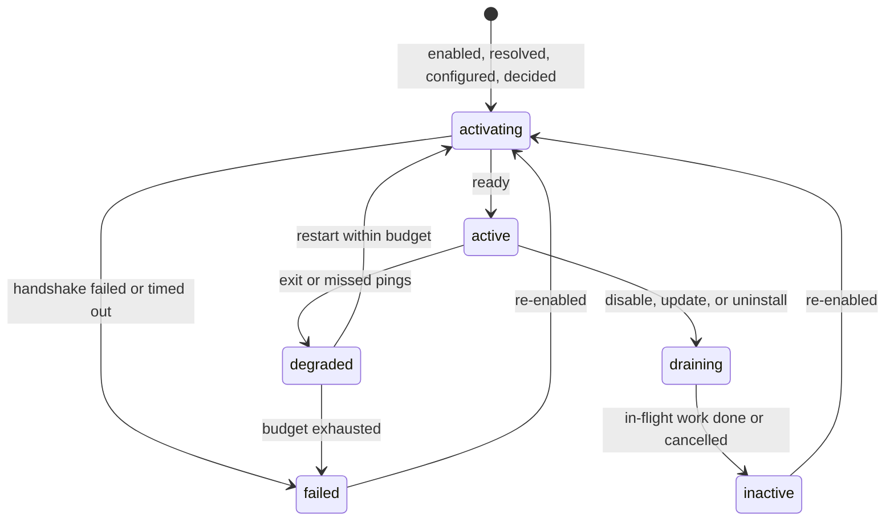

# Amadeus Extension Protocol v0.1

> **Status: draft for discussion.** An unmerged Amadeus experimental branch
> implements the restart-based TTS/MCP/Skill subset in §1.3.1; no stable SDK has shipped.
> First draft: 2026-10-05. Implementation alignment: 2026-10-12.
> Product baseline: Amadeus 6147acbc36e2b16faa5d8192a873d40a7feb5965.
> Interfaces may change; schema validation does not prove runtime support or
> full v0.1 conformance. TTS/MCP/Skill remain provisional.

This specification defines how third-party extensions declare, install, run, and
contribute capabilities to Amadeus without depending on Amadeus internals. It
covers the package manifest, the lifecycle a Host manages, the permission model,
and the protocol between the Host and an extension process.

Companion documents:

| Document | Status |
| --- | --- |
| [Voice backend contracts](contracts/voice-v0.md) (`amadeus.voice.tts/v0`, `amadeus.voice.asr/v0`) | TTS and ASR provisional |
| [Context source contract](contracts/context-source-v0.md) (`amadeus.context.source/v0`) | Provisional |
| [Observer contract](contracts/observer-v0.md) (`amadeus.events.observer/v0`) | Provisional |
| [Theme contract](contracts/theme-v0.md) (`amadeus.ui.theme/v0`) | Provisional; local P1/P2 implementation under review |
| [Manifest JSON Schema](../schemas/amadeus-extension.v0.schema.json) | Normative |
| [Reference manifest validator](../tools/validate_manifest.py) | Informative |
| [Example packages](../examples/) | Informative |

## Contents

1. [Introduction](#1-introduction)
2. [Model](#2-model)
3. [Manifest](#3-manifest)
4. [Lifecycle](#4-lifecycle)
5. [Permissions](#5-permissions)
6. [Runner protocol](#6-runner-protocol)
7. [Catalog projection](#7-catalog-projection)
8. [Packaging and installation](#8-packaging-and-installation)
9. [Security considerations](#9-security-considerations)
10. [Versioning](#10-versioning)
11. [Conformance](#11-conformance)
12. [Open questions](#12-open-questions)
- [Appendix A: Mapping to the current Amadeus implementation](#appendix-a-mapping-to-the-current-amadeus-implementation)
- [Appendix B: Implementation impact on Amadeus](#appendix-b-implementation-impact-on-amadeus)

## 1. Introduction

### 1.1 Goals

- Developers can build an extension against a small public contract, without
  importing or understanding Amadeus internals.
- Users can install, configure, enable, disable, update, and remove extensions
  in one place. Supported extension changes take effect at the native owner's
  admission boundary; this does not promise hot switching of every existing
  built-in backend or Provider process.
- Authority stays with the Host. Installing or enabling an extension never
  grants it product authority.
- Contributions are reusable. The protocol aligns with open standards where
  they exist (MCP, Agent Skills, ACP, AUIP) and publishes Amadeus-specific
  contracts as versioned specifications.

### 1.2 Non-goals for v0.1

- Marketplace features such as ratings, payments, and automatic updates.
- Operating-system sandboxing guarantees (see [§9.1](#91-isolation-scope)).
- Remote or multi-user Hosts.
- Services that one extension provides to another.
- User-interface code contributed by extensions.

### 1.3 Pilots

Provisional parts of this draft become normative only after a real extension
uses them and passes the acceptance checks listed with each pilot:

| Pilot | Exercises | Acceptance (both the success and the failure side) |
| --- | --- | --- |
| External TTS backends: Fish Audio (Japanese/English), MiMo (English only) | Runner, `voice_backend` TTS, config/secrets, restart-based lifecycle | Installing changes no Amadeus source file. Review identity, commands and OS disclosures before preparation or enablement. Keys never appear in package files or logs. Saving disable/configuration/selection leaves the current process unchanged and is visibly pending restart. Backend shutdown cancels or bounds admitted work and removes owned children; the next start applies the saved selection. Slow cancellation within the cleanup grace drops late audio without restarting the Runner. Overdue cancellation and actual crashes use bounded recovery without replaying synthesis. Fish provides Japanese pilot coverage; MiMo English live acceptance remains pending. No configuration-generation handover is required. |
| A memory recall extension | `context_source`, scoped source access and memory governance; `observer` only when needed | A late result never delays a turn and is recorded as dropped. Forgotten items never return. Uninstalling handles data as the user chose, and earlier provenance shows the source as removed. |
| A task companion | `observer`, `presentation:notify` | A revoked capability stops the next delivery or call, reports the capability name, and affects no other extension. |

### 1.3.1 Amadeus experimental Host profile (informative)

The 2026-10-12 local pilot implements a local-wheel subset with backend
owners: TTS (MiMo English and Fish Audio Japanese/English) and declarative
MCP (a package-owned Notes service bound to compatible Work Providers), and
Agent Skills (one installed package bound to selected Codex, ACP or Pi Agents).
A data-only theme owner applies literal palettes and bounded package images in
the desktop. The theme contract remains provisional pending pilot acceptance.
MiMo does not support Japanese, confirmed by the project owner; no Japanese
MiMo audition is pending. Real MiMo English acceptance awaits a configured key.

Backend install, configuration, enable/disable, selection and removal changes
apply after backend restart, including built-in/extension TTS transitions. A stable TTS
proxy lives for the backend process. Runner crash recovery occurs inside it and
never replays a failed synthesis. The pipeline does not hot-swap runtimes.
Manifest live/reactivate labels do not override backend restart semantics:
saved values are delivered in the next initialize snapshot. Pure frontend theme
packages apply without restarting the backend. A version switch involving an
old or new backend contribution uses the backend boundary for the whole package;
frontend contributions keep the actual loaded snapshot until then. Disabling
or removing immediately closes frontend admission; a still-running backend is
shown separately. Re-enabling a mixed package requires restart before reopening
its frontend contributions.
General live configuration/generation handover below remains future design,
not a requirement of this experimental subset.

Electron main owns the entire install transaction, desired records, encrypted
secret bindings and revisions. Python consumes a read-only startup snapshot.
The profile rejects nonempty permissions.host, so it stores no Grant records.
Runner environment starts from an explicit platform allowlist, then its own
bindings; it must never copy the Host environment or another package's secrets.
Removal defaults to retaining package data, with explicit deletion available.
The selected unavailable TTS id remains visible; text continues without a
silent fallback. No record/disk scan recreates activation or trust.

MCP uses real Provider connection projection, not Main Chat tools. Skills use
Codex process-level extra roots and native discovery, Pi explicit --skill paths
and native discovery, or a portable name/description/path catalog in ACP prompts.
Agents read skill bodies and referenced resources using their existing tools.
Generic ACP defaults to a portable file catalog. Explicit ACP configuration
`skill_discovery=dsh` adds the selected contribution directories through DSH's
startup overlay; DSH retains its registry and native tools. This is not a
manifest field or a universal ACP skill-install RPC. The pilot covers Codex ACP
2.2.2 with a controlled model, and DSH 0.2.0-rc.2 with controlled and real models.
DSH's MCP client 2.0.0 has a reproduced diagnostic-to-stdout defect when listing
unsupported resources; its Windows sandbox also requires workspace WRITE_OWNER
for integrity labels. Neither condition is resolved by weakening Host parsing
or execution policy. Keep this combination experimental pending clean-wire and
sandbox-environment qualification.

Skill native sessions carry the Host-owned set of selected package/contribution
revisions (version, digest and installation path). Adding Skills does not
invalidate existing sessions; updating, removing, unbinding or relocating a
previously recorded Skill requires a new native session. Changes to another
Agent do not invalidate this one. Older experimental opaque-digest handles can
upgrade after an unchanged resume; a changed opaque digest cannot identify its
old set and requires an explicit new session. Native name conflicts are shown
as an unavailable Skill and do not disable unrelated Agent work.

The versioned implementation map is Amadeus `docs/extension_host_profile_v0.1.md`.
Work outputs do not register extensions: ordinary files and verified AUIP apps
share ledger provenance but have distinct views and activation paths. Exact
application members are shown in app details; independent reports remain files.
These Host UI reads do not grant packages artifact or history access.

ASR, context_source, observer and third-party surfaces remain unsupported.
Explicit same-id, different-version wheel updates prepare beside the running
version, preserve compatible settings/bindings and commit only after validation.
Old code is removed only after confirmed backend shutdown. No marketplace,
automatic update, source/editable install or broad discovery is implemented.
Built-in MiMo stays; legacy migration is outside P1.

This is a partial experimental implementation, not full v0.1 conformance or a
published SDK. TTS, MCP and Skill remain provisional until their agreed pilot
acceptance is complete. One successful live synthesis is not certification.
Memory follows M0 bounded Host recall, M2 explicit Host memory, then M1 external
memory; source access and correction/forget rules must precede external access.

### 1.4 Conventions

The key words MUST, MUST NOT, REQUIRED, SHALL, SHALL NOT, SHOULD, SHOULD NOT,
RECOMMENDED, MAY, and OPTIONAL are to be interpreted as described in RFC 2119
and RFC 8174 when, and only when, they appear in all capitals.

Each part of this specification has one of three statuses:

- **Normative**: Hosts and extensions implementing v0.1 follow it.
- **Provisional**: drafted for a pilot. Implementations MAY support it, and
  nothing may rely on its compatibility until it becomes normative.
- **Reserved**: the name is reserved for a future version and MUST NOT be used.

“Normative” describes validated requirements, not merely proposed syntax.
TTS/MCP/Skill stay provisional under §1.3 until pilot acceptance is complete;
the experimental subset must not advertise full v0.1 Host conformance.

All JSON is UTF-8 without a byte order mark.

## 2. Model

### 2.1 Terms

- **Host**: the Amadeus desktop application and backend acting together. The
  Host owns identity, durable state, permissions, execution authority, and
  ledger facts.
- **Package**: one installable unit described by one manifest.
- **Contribution**: one capability a package provides, identified by `kind` and
  `id`, and consumed by exactly one native owner.
- **Native owner**: the Host subsystem that consumes and validates a
  contribution kind, for example the TTS registry or the MCP connection
  registry.
- **Binding**: the projection of a contribution onto a Host product surface, as
  in the Capability Catalog.
- **Grant**: the Host's record of which Host capabilities the user approved for
  a package.
- **Activation**: one running instance of a package. Each Activation has a
  generation number.
- **Runner**: the process that runs a package's code and speaks the protocol in
  [§6](#6-runner-protocol).
- **Admission boundary**: the point at which a native owner chooses a
  contribution for new work, for example the next utterance for TTS.

### 2.2 Invariants

These invariants hold for every part of this specification, including future
contribution kinds.

1. **Installation is not authority.** Installing, enabling, or updating a
   package never grants product authority. Authority comes only from Grants and
   from the permission paths the native owner already has.
2. **One owner per contribution.** Each contribution is consumed and validated
   by exactly one native owner. The extension system does not become a second
   source of truth for native payloads.
3. **Three call paths.** An extension is reached in exactly one of three ways:
   - **Host-invoked**: the Host calls the contribution inside its own flow
     (voice backends, context sources, observers). Models do not see these
     contributions.
   - **Work delegation**: a Work Provider uses the contribution under the
     existing Work permissions (Skills and MCP servers).
   - **AUIP typed actions**: an application declares actions, and the Host
     validates and dispatches them and accepts receipts (reserved for a future
     version).

   Main Chat never executes extension code or extension tools directly.
4. **Context is evidence.** Content an extension contributes to Main Chat is
   bounded, attributed, visible, and revocable. It is never instructions,
   persona, system prompt, or conversation history.
5. **Boundary-aligned changes.** A contribution change takes effect at the
   native owner's next admission boundary. Work in flight finishes on the
   implementation that started it or is cancelled by the owner's policy. It
   never switches implementation midway.
6. **Crash-only reclamation.** The Host can reclaim every registration, process,
   and in-flight call of an Activation without the extension's cooperation.
7. **What runs is what was declared.** A Runner registers exactly the
   contributions in its manifest.

## 3. Manifest

### 3.1 Location and encoding

A package carries one manifest named `amadeus-extension.json` (see
[§8.1](#81-package-forms) for its location). The manifest is UTF-8 JSON without
a byte order mark and at most 256 KiB. A valid manifest validates against
[`schemas/amadeus-extension.v0.schema.json`](../schemas/amadeus-extension.v0.schema.json)
and satisfies the rules in [§3.9](#39-semantic-rules). The Host reads the
manifest without executing package code.

Unknown fields are rejected at every level. A newer manifest format uses a new
`schema` value instead of adding fields that older Hosts would misread.

### 3.2 Top-level fields

| Field | Required | Value |
| --- | --- | --- |
| `schema` | yes | `"amadeus.extension/v0"` |
| `id` | yes | Package id ([§3.3](#33-identifiers)) |
| `version` | yes | Exact Semantic Versioning 2.0.0 version |
| `display_name` | yes | Localized text, at most 80 characters |
| `description` | yes | Localized text, at most 500 characters |
| `author` | yes | `{ "name", "email"?, "url"? }` |
| `license` | no | SPDX license expression. An index MAY require it. |
| `homepage`, `repository` | no | `https://` URL |
| `engines` | yes | [§3.4](#34-engines) |
| `runtime` | yes | [§3.5](#35-runtime) |
| `contributes` | yes | [§3.6](#36-contributes); at least one contribution |
| `config` | no | [§3.7](#37-config) |
| `permissions` | no | [§3.8](#38-permissions) |

**Localized text** is either a string or an object that maps language tags
(for example `en`, `zh-CN`, `ja`) to strings. A Host displays the entry for the
user's language, then `en`, then the first entry.

### 3.3 Identifiers

- **Package id**: lowercase reverse-DNS form with at least two segments, for
  example `io.github.alice.mimo-tts`, at most 128 characters. Ids beginning
  with `amadeus.` are reserved for built-in packages. An index verifies
  namespace ownership ([§8.4](#84-index)).
- **Contribution id**: `^[a-z][a-z0-9_-]{0,63}$`, unique per kind within a
  package.
- **Qualified contribution id**: `<package id>/<contribution id>`. The Host uses
  qualified ids wherever it persists or displays a selection, such as the
  selected TTS backend, so two packages can never collide. Built-in
  contributions keep their existing unqualified ids.
- **Config key**: `^[a-z][a-z0-9_]{0,63}$`.

### 3.4 engines

| Field | Required | Value |
| --- | --- | --- |
| `amadeus_host_api` | yes | Version range of the Host API ([§10](#10-versioning)) |
| `platforms` | no | Non-empty subset of `win32`, `darwin`, `linux`. Default: all. |

A **version range** is one or more comparators separated by commas, all of
which must hold. A comparator is one of `>=`, `<=`, `>`, `<`, `==`, `!=`
followed by a dotted numeric version, for example `>=0.1,<0.2`. This draft
defines Host API `0.1`.

### 3.5 runtime

`runtime.kind` selects how much of the package executes:

| `kind` | Fields | Meaning |
| --- | --- | --- |
| `none` | — | Declarative package. Amadeus executes none of its code. |
| `python` | `requires_python` (required), `entry` (optional) | The Host creates an isolated Python environment for the package. When `entry` is present, the Host also starts a Runner ([§6](#6-runner-protocol)). |

`entry` names the Runner's extension object in `module:attribute` form. It is
present exactly when the package contributes a Runner kind
([§3.6](#36-contributes)). `requires_python` uses the version range grammar,
for example `>=3.12`.

A package declares its Python dependencies only in its own distribution
metadata. The manifest does not repeat them.

`node` is reserved.

### 3.6 contributes

`contributes` maps contribution kinds to non-empty arrays of contributions.
Every contribution has these fields:

| Field | Required | Value |
| --- | --- | --- |
| `id` | yes | Contribution id |
| `contract` | yes | The contract the contribution implements; allowed values below |
| `title` | no | Localized text, at most 80 characters |
| `summary` | no | Localized text, at most 500 characters |

Kinds in v0.1:

| Kind | Status | Runner kind | `contract` | Native owner | Defined in |
| --- | --- | --- | --- | --- | --- |
| `voice_backend` | TTS and ASR provisional | yes | `amadeus.voice.tts/v0`, `amadeus.voice.asr/v0` | TTS and ASR registries | [voice-v0](contracts/voice-v0.md) |
| `skill` | provisional | no | `amadeus.skill/v0` | Work Provider skill projection | [§3.6.1](#361-skill) |
| `mcp_server` | provisional | no | `amadeus.mcp-server/v0` | MCP connection registry | [§3.6.2](#362-mcp_server) |
| `theme` | provisional | no | `amadeus.ui.theme/v0` | Desktop theme owner; not projected into Work execution | [Theme contract](contracts/theme-v0.md) |
| `context_source` | provisional | yes | `amadeus.context.source/v0` | Main Chat context assembly | [context-source-v0](contracts/context-source-v0.md) |
| `observer` | provisional | yes | `amadeus.events.observer/v0` | Host event projection | [observer-v0](contracts/observer-v0.md) |

Runner kinds require `runtime.kind = "python"` with an `entry`. Declarative
kinds may appear in any package.

Reserved kinds: `surface`, `channel`, `proactive`, `provider`, `auip_app`,
`character_pack`. Reserved voice role: `wake`.

#### 3.6.1 skill

A skill contribution packages one Agent Skills directory.

| Field | Required | Value |
| --- | --- | --- |
| `path` | yes | Package-relative path of a directory that contains `SKILL.md` |

- The Host exposes the installed version directory for read access only to Work Providers
  that support the Agent Skills projection. Skills are never exposed to Main
  Chat.
- The directory MUST NOT contain symbolic links or junctions and MUST NOT
  exceed 16 MiB.
- Skill text reaches a model. See [§9.3](#93-prompt-injection).

The Amadeus experimental profile validates SKILL.md frontmatter name and
description, bounds metadata, requires the directory name to match the skill
name and rejects conflicting names bound to one Agent. Skill references grant
no extra shell or write permission. Pi permits reading the selected resource
roots without allowing writes or access to neighboring package files.

Native process tests use a deterministic local model endpoint to verify discovery,
actual file tools, generated reports, native session restoration and changed
revision rejection. These results do not certify autonomous model selection quality.

#### 3.6.2 mcp_server

An MCP server contribution describes how the Host starts or reaches one MCP
server. The Host converts it into an entry in its existing MCP connection
registry. As with connections the user adds by hand, the user chooses which
Work Providers may use the server, and MCP tools never reach Main Chat.

Transport `stdio`:

| Field | Required | Value |
| --- | --- | --- |
| `transport` | yes | `"stdio"` |
| `command` | yes | `${python}`, a path under `${package}/`, or a bare executable name |
| `args` | no | Array of at most 64 template strings |
| `env` | no | Object mapping environment variable names to template strings |

Transport `http`:

| Field | Required | Value |
| --- | --- | --- |
| `transport` | yes | `"http"` |
| `url` | yes | `http://` or `https://` URL, or a `${config.<key>}` reference |
| `bearer_token` | no | Exactly one `${config.<key>}` reference to a secret field |

**Template strings** may contain these variables:

| Variable | Value |
| --- | --- |
| `${package}` | Absolute path of the package directory (read-only) |
| `${data}` | Absolute path of the package's persistent data directory |
| `${python}` | Interpreter of the package's Python environment (`runtime.kind = "python"` only) |
| `${config.<key>}` | The config value as a string: strings as stored, numbers in JSON form, booleans as `true` or `false`, an unset optional value as an empty string |

v0.1 has no escape for a literal `${`.

Secret config values MAY appear only in `env` values and in `bearer_token`.
They MUST NOT appear in `command`, `args`, or `url`, because command lines and
URLs are visible in process listings and logs. A bare `command` MUST be listed
in `permissions.os.process` ([§3.8](#38-permissions)), because the Host resolves
it on `PATH` and runs whatever program it finds there.

A `python` package may contribute an MCP server without a Runner:

```json
"runtime": { "kind": "python", "requires_python": ">=3.11" },
"contributes": {
  "mcp_server": [{
    "id": "notes",
    "contract": "amadeus.mcp-server/v0",
    "transport": "stdio",
    "command": "${python}",
    "args": ["-m", "example_notes_mcp"],
    "env": { "NOTES_DIR": "${data}/notes" }
  }]
}
```

### 3.7 config

`config` maps config keys to field definitions, at most 64 fields. The Host
generates its settings form from these definitions in manifest order and stores
the values. Packages receive these values from the Host and do not keep a
second copy of Host-managed settings.

| Field | Required | Value |
| --- | --- | --- |
| `type` | yes | `string`, `url`, `boolean`, `integer`, `number`, or `enum` |
| `title` | yes | Localized text, at most 80 characters |
| `description` | no | Localized text, at most 500 characters |
| `required` | no | Boolean, default `false` |
| `default` | no | A value of the field's type. Not allowed with `secret`. |
| `secret` | no | Boolean, `string` fields only ([§9.2](#92-secrets)) |
| `options` | `enum` only, required | 1 to 64 entries, each a string or `{ "value", "label"? }` |
| `min`, `max` | `integer` and `number` only | Inclusive bounds |
| `max_length` | `string` and `url` only | 1 to 16384, default 4096 |
| `apply` | no | `live` (default) or `reactivate` |

- A change to a `live` field reaches a running Runner through `config.changed`
  ([§6.4](#64-lifecycle-messages)). A change to a `reactivate` field starts a
  new generation ([§4.4](#44-generations)). Declarative contributions see a
  change at their native owner's next admission boundary, for example when the
  next MCP session starts.
- While a `required` field has no value, the package stays in `needs_config`
  ([§4.2](#42-observed-state)) and does not start.

#### 3.7.1 Relation to built-in configuration (informative)

Amadeus now derives built-in fields, backend factories/probes and generated
desktop settings from `config/catalog`. These files are trusted packaged data,
not installable extension manifests. Share basic type/value checks and field
rendering, not the complete validator or the static environment-key allowlist.

In particular, built-in `apply` values describe application restart boundaries;
extension `live` / `reactivate` describe Activation/configuration boundaries.
The manifest's `required`, secret-without-default rule, localized text bounds
and namespaced keys require their own checks. Internal `factory`, `probe`,
`runtime_key` and `computed_default` fields never become extension inputs.
New packages are runtime records, not generated catalog entries.

For a `live` update, an in-flight contribution request keeps the configuration
snapshot with which it was admitted. New requests use the new configuration.
Clearing a required value stops new admission until configuration is valid;
retaining an old generation must not bypass that rule.

### 3.8 permissions

| Field | Value |
| --- | --- |
| `host` | Array of `{ "capability", "reason" }`. `capability` is one of the Host capabilities in [§5.2](#52-host-capabilities-in-v01); `reason` is localized text of at most 200 characters, shown when the user decides. |
| `os` | Disclosure of what the package's own processes do outside Amadeus: `network` (host names, `*.` wildcards, or `*`), `filesystem` (`{ "path", "access": "read" \| "read_write" }`), and `process` (executable names or `*`). |

Host capabilities are enforced by the Host ([§5](#5-permissions)). In v0.1, OS
disclosures are shown to the user but not enforced ([§9.1](#91-isolation-scope)).
A package does not need to declare its own package, data, cache, or temporary
directories.

### 3.9 Semantic rules

A valid manifest also satisfies these rules, which the JSON Schema does not
express. The reference validator reports them with the codes shown.

| Code | Rule |
| --- | --- |
| S1 | Contribution ids are unique per kind within the package. |
| S2 | Runner kinds require `runtime.kind = "python"` with an `entry`. |
| S3 | Every `${config.<key>}` names a declared key; secret keys appear only in `env` values and `bearer_token`; `bearer_token` names a secret key; every `${` is closed; no other variables appear. |
| S4 | `${python}` appears only when `runtime.kind = "python"`. |
| S5 | Every observer topic's required capability ([observer-v0](contracts/observer-v0.md)) is listed in `permissions.host`. |
| S6 | An `enum` default is one of its options and option values are unique; numeric bounds satisfy `min <= max` and contain the default; a string default fits `max_length`. |
| S7 | Each capability appears at most once in `permissions.host`. |
| S8 | A stdio `command` is `${python}`, a package path without `..` or hidden segments, or a bare name listed in `permissions.os.process`. |
| S9 | `runtime.entry` is present only when the package contributes a Runner kind. |

### 3.10 Package checks

When a Host or validator has the package contents, it also checks:

| Code | Check |
| --- | --- |
| P1 | The manifest exists, is at most 256 KiB, and parses as JSON. |
| P2 | Each skill `path` is a directory inside the package that contains `SKILL.md`, contains and passes through no links, and is at most 16 MiB. |
| P4 | Theme background resources are contained, unlinked PNG/JPEG files of at most 8 MiB. The Host also validates decoded size, token literals and rendered contrast before activation. |
| P3 | Each `${package}/…` command exists inside the package without passing through links. |

## 4. Lifecycle

### 4.1 Desired state

For each installed package the Host persists: package id, version, source,
artifact digest, provenance, whether the user enabled it, Grant decisions, and
non-secret config values. Secret values are kept in the Host's secret store.

The Host MUST write this record crash-safely: write a temporary file, flush it
to stable storage, replace the record atomically, and keep the previous copy. A
record that cannot be parsed MUST NOT be treated as empty; the Host reports it,
keeps it for recovery and stops extension activation until a valid record is
recovered. Ordinary Chat and unaffected built-in capabilities remain usable.

Amadeus's first desktop implementation should keep one durable desired-state
owner in Electron main, alongside its existing encrypted settings and revision
handling. Python owns Activation and native registration, not another editable
copy of the same desired state. Saving and applying a revision are separate
observable outcomes. Atomic file replacement is not a transaction across
installation files, secret records and runtime state; the implementation must
define preparation, commit and recovery explicitly. The existing desktop
settings reader can eventually recover ordinary settings to defaults. That
recovery policy must not be copied for extension authorization records: keep
their corruption visible and activation blocked instead of treating it as a
new installation.

### 4.2 Observed state

The Host derives an observed state for each enabled package at runtime. It is
not persisted.

| State | Meaning |
| --- | --- |
| `incompatible` | `engines`, `platforms`, or a contract version is not supported by this Host. The detail names the reason. |
| `needs_config` | A `required` config field has no value. |
| `awaiting_grant` | The user has not yet decided on every requested Host capability. |
| `activating` | The Runner is starting or the handshake is in progress. |
| `active` | The package can serve work. Declarative packages become `active` directly. |
| `degraded` | The Runner stopped responding or exited and the Host is restarting it. Admission is closed. |
| `draining` | The package is being disabled, updated, or removed. No new work is admitted. |
| `inactive` | Disabled by the user, or stopped after draining. |
| `failed` | The restart budget is exhausted. The package stays stopped until the user re-enables it. |



Each contribution also has a health value: `starting` until the Runner reports
otherwise, then `ready`, `degraded` (usable with reduced quality), or `error`
(unusable). Declarative contributions report the health their native owner
observes.

### 4.3 Admission and draining

- A native owner admits new work to a contribution only if its package is
  `active` and the contribution's health is `ready` or `degraded`.
- When a package enters `draining`, admission closes. In-flight calls may run
  until the drain timeout (default 10 seconds), after which the Host cancels
  them and sends `shutdown`. A contract MAY define a shorter drain for its
  calls.
- Each contract defines its admission boundary.

### 4.4 Generations

Updating a package, reloading it in development mode
([§8.3](#83-development-mode)), or changing a `reactivate` field starts
generation N+1 while generation N stays active. When N+1 becomes active, native
owners move to it at their next admission boundary, and N drains. If N+1 fails,
N keeps serving and the Host reports the failure. This preservation applies
only while N is still authorized, enabled and configured. Disablement, cleared
required secrets and grant revocation close the relevant admission regardless
of a replacement failure. A package never runs two generations past the drain
of the older one.

### 4.5 Failure handling

- When a Runner exits or misses two consecutive pings, its Activation becomes
  `degraded`. Admission closes, the Host removes the Activation's registrations,
  and in-flight calls fail with `extension_unavailable`. Native owners apply
  their fallback, defined by each contract.
- The Host restarts the Runner with backoff (1, 5, then 30 seconds). After three
  restarts within ten minutes the package becomes `failed`.
- A handshake that fails validation, such as a registration mismatch, makes the
  package `failed` without retries.

A Runner restart is observable infrastructure recovery. It MUST NOT replay a
failed or partially served synthesis request, repeat a paid remote POST for
that request, or replay audio already delivered. Late results from cancelled
requests or obsolete Activations are discarded. Recovery serves new work only.

### 4.6 Uninstall

The Host drains and stops the package, removes its environment and files, and
deletes its secrets. It asks the user whether to delete or keep the package's
data directory. References to the package recorded elsewhere, such as context
provenance in a Session, remain and display the source as removed.

## 5. Permissions

### 5.1 Model

- **Effective grants** are the capabilities the manifest requests and the user
  granted. The user decides on each requested capability separately. A package
  runs with whatever subset was granted and is expected to degrade gracefully.
- Decisions are stored per package, not per version. When a new version
  requests a capability that has no decision yet, that version does not activate
  until the user decides. The previous version keeps running meanwhile
  ([§4.4](#44-generations)).
- Revocation takes effect immediately. The Host rejects later calls that need
  the capability, cancels deliveries that depend on it, and sends
  `grants.changed`.
- The Host checks every Host service call and every delivery against the
  Activation's effective grants. Methods outside the protocol are rejected.
- A contribution's inherent inputs are authorized by the user's choice to use
  the contribution, not by Host capabilities. A TTS backend the user selected
  receives the text it must speak.

### 5.2 Host capabilities in v0.1

Capability names have the form `<domain>[.<resource>]:<action>`. A manifest may
request only the capabilities listed here.

| Capability | Status | Allows |
| --- | --- | --- |
| `conversation.current:read` | provisional | Receiving the current user turn text in `context.query` |
| `conversation.history:read` | provisional | Receiving completed turns through the `conversation.turn.completed` topic |
| `events.work:read` | provisional | Receiving Work item projections through the `work.item.updated` topic |
| `presentation:notify` | provisional | Submitting facts to the Host's narration policy ([§6.5](#65-host-services)) |

Reserved: `presentation:speak_verbatim`, `audio.mic:stream`, `screen:capture`,
`character.assets:read`.

### 5.3 Authority that is never grantable

No capability, in any version of this protocol, lets an extension:

- complete, accept, or reopen a Work item, or write Work Ledger facts;
- resolve permission requests or approve actions;
- issue AUIP receipts or act as another application;
- write Main Chat's persona, system prompt, or conversation history;
- create user turns as the local user, by voice or text;
- read another package's configuration, secrets, data, or grants;
- obtain the desktop authentication credentials.

### 5.4 OS disclosures

The Host shows `permissions.os` before installing, enabling, or updating a
package, and asks again when a new version discloses more. In v0.1 the Host MUST
NOT describe these disclosures as enforced.

## 6. Runner protocol

### 6.1 Process and transport

- The Host starts one Runner process per Activation. For `runtime.kind =
  "python"`, it starts the package environment's interpreter with the reference
  SDK's Runner module and the manifest `entry`. Any other Runner implementation
  MUST behave identically on the wire.
- Standard input and output carry JSON-RPC 2.0 messages, one per line (UTF-8,
  at most 8 MiB per line). Standard output carries only protocol messages.
  Standard error is free-form log text, which the Host stores in the package's
  log after redacting the package's secret values.
- The Runner's environment contains only an allowlist of platform variables and
  proxy settings. It MUST NOT contain Host authentication material, Host
  credentials, or other packages' secrets. Secrets reach the Runner only through
  `initialize` and `config.changed`.
- The Runner's working directory is the package data directory.

### 6.2 Message conventions

- Both sides send requests. Request ids are unique per sender for the lifetime
  of the connection.
- Method names: `$/…` for protocol messages, `host.…` for Host services, and
  contract namespaces such as `tts.…` for calls into contributions.
- A receiver responds to an unknown request method with error `-32601` and
  ignores unknown notifications.
- A Host request MAY include `deadline_ms`, a relative deadline. The Host
  cancels the request when it elapses.
- Either side cancels a request with the notification
  `$/cancel { "id": <request id> }`. The receiver stops the work and responds
  with error `cancelled`, or with the result if the work had already finished.
- Notifications that belong to a request (for example audio chunks) carry its
  id as `request_id` and are sent before its response. The receiver discards
  any that arrive later.
- **Opaque references** such as `session_ref` and `work_item_ref` are stable for
  one package and one underlying object, and do not reveal the Host's own
  identifiers. A Host MAY derive them with a keyed hash.
- In message transcripts in this specification, `→` is a message from the Host
  to the Runner and `←` is a message from the Runner to the Host.

### 6.3 Handshake

1. The Host sends `initialize`:

   ```json
   {"jsonrpc": "2.0", "id": 1, "method": "initialize", "params": {
     "protocol": "amadeus.extension-rpc/v0",
     "host": {"name": "amadeus", "version": "0.16.0", "host_api": "0.1"},
     "package": {"id": "com.example.mimo-tts", "version": "0.1.0"},
     "activation": {"id": "act-7f3c", "generation": 1},
     "config": {"base_url": "https://api.xiaomimimo.com/v1", "model": "mimo-v2.5-tts", "voice": "冰糖"},
     "secrets": {"api_key": "<secret>"},
     "grants": [],
     "paths": {"package": "…", "data": "…", "cache": "…", "temp": "…"},
     "locale": "zh-CN"
   }}
   ```

2. The Runner answers with its SDK identity and the contributions it
   registered:

   ```json
   {"jsonrpc": "2.0", "id": 1, "result": {
     "sdk": {"name": "amadeus-sdk", "version": "0.1.0"},
     "contributions": [
       {"kind": "voice_backend", "id": "mimo", "contract": "amadeus.voice.tts/v0"}
     ]
   }}
   ```

   The Host compares `contributions` with the manifest. Any difference in kind,
   id, or contract fails the Activation with `registration_mismatch`.
3. When the Runner can accept calls, it sends the notification `ready`. The Host
   admits work only after `ready`. If `ready` does not arrive within 30 seconds
   of process start, the Activation fails.
4. The Runner reports each contribution's health with the notification
   `contribution.health { "kind", "id", "health", "detail" }`, where `health`
   is `ready`, `degraded`, or `error` and `detail` is at most 240 characters.
   A contribution can report `ready` after `ready` was sent, for example when a
   model finishes loading.

### 6.4 Lifecycle messages

| Message | Direction | Kind | Meaning |
| --- | --- | --- | --- |
| `$/ping` | Host → Runner | request | Liveness. The Runner answers `{}` within 5 seconds. The Host SHOULD ping every 15 seconds without other traffic. |
| `config.changed` | Host → Runner | notification | Complete snapshot `{ "config", "secrets" }` after a `live` field changed |
| `grants.changed` | Host → Runner | notification | `{ "grants" }` after a decision or revocation |
| `shutdown` | Host → Runner | request | The Runner stops accepting work, releases its resources, and answers `{}`. The Host then closes standard input; the Runner exits within 5 seconds or is terminated. |
| `ready` | Runner → Host | notification | See [§6.3](#63-handshake) |
| `contribution.health` | Runner → Host | notification | See [§6.3](#63-handshake) |

### 6.5 Host services

v0.1 defines one Host service. Logging uses standard error, and directories
arrive in `initialize`.

**`host.presentation.notify`** (provisional; requires `presentation:notify`)

| Param | Value |
| --- | --- |
| `fact` | Plain text of at most 500 characters stating what happened |
| `urgency` | `low`, `normal`, or `high` |
| `source_ref` | Optional reference of at most 200 characters, such as a `work_item_ref` |

Result: `{ "disposition": "queued" | "suppressed" | "rejected", "reason"? }`.

The Host's narration policy decides whether, when, and how the character
mentions the fact, keeping it consistent with the character's persona and the
current conversation. The extension never controls the wording. The Host
records the origin of every fact it accepts and MAY rate-limit a package with
error `rate_limited`.

### 6.6 Errors

| Code | Name | Meaning |
| --- | --- | --- |
| -32700, -32600, -32601, -32602, -32603 | JSON-RPC | Standard JSON-RPC 2.0 errors |
| -32001 | `capability_denied` | The call needs a capability that is not in the effective grants. `data.capability` names it. |
| -32002 | `not_ready` | The Activation or contribution is not ready. |
| -32003 | `cancelled` | The request was cancelled. |
| -32004 | `deadline_exceeded` | The deadline elapsed. |
| -32005 | `rate_limited` | Too many calls. `data.retry_after_ms` MAY be present. |
| -32006 | `extension_unavailable` | The Activation stopped while the call was in flight (used by the Host toward its own callers and in records). |
| -32010 | `contribution_error` | The contribution failed. `data.retryable` is a boolean and `data.detail` explains the failure. |

Error messages may be shown to users. They MUST NOT contain secret values.

### 6.7 Limits

| Limit | Default |
| --- | --- |
| Concurrent requests from the Host per Activation | 16 |
| Time from process start to `ready` | 30 seconds |
| Ping interval / ping timeout | 15 seconds / 5 seconds |
| Drain timeout | 10 seconds |
| Shutdown grace | 5 seconds |
| Restart budget | 3 restarts within 10 minutes, backoff 1, 5, 30 seconds |
| Line size | 8 MiB |

Hosts MAY choose stricter limits and SHOULD show them in diagnostics.

## 7. Catalog projection

The Host's Capability Catalog becomes the read model of installed packages:

| Catalog field | Value for an extension package |
| --- | --- |
| package id, version, source, digest | From the install record |
| `trust` | `trusted_local` for `runtime.kind = "none"`; `external_protocol` for `python` |
| `provenance` (new) | `builtin`, `verified`, `community`, or `local` ([§8.4](#84-index)) |
| contribution kinds | Adds `voice_backend`, `context_source`, and `observer` |
| health | From [§4.2](#42-observed-state) and contribution health |

| Contribution | Binding surface / projection |
| --- | --- |
| `voice_backend` (TTS) | `voice` / `tts_backend` |
| `voice_backend` (ASR) | `voice` / `asr_backend` |
| `skill` | `work_execution` / `agent_skill` |
| `mcp_server` | `work_execution` / `mcp_connection` |
| `context_source` | `role_chat` / `context_source` |
| `observer` | `host_events` / `observer` |

The extension manager in the Host writes this state. The Catalog only projects
it and remains outside routing and execution, as in Catalog v0. Activation
state and contribution health are different: the current Catalog accepts only
`ready`, `degraded`, `error` and `disabled`. The implementation must deliberately
map states such as `activating` and `needs_config` into its read model while
retaining an explanatory detail; it must not pass them as existing health enum
values. P1 adds only the voice contribution needed by its real caller.

## 8. Packaging and installation

### 8.1 Package forms

**Wheel.** A `python` package is a standard Python wheel.

- It declares exactly one entry point in group `amadeus.extensions`. The entry
  point's name is the package id, and its value is the top-level import package
  that contains `amadeus-extension.json`.
- `${package}` is that import package's directory. Files referenced by
  declarative contributions are package data inside it.
- `runtime.entry`, when present, names an object inside the same top-level
  package.

**Archive or directory.** A `none` package is a directory or a ZIP archive with
`amadeus-extension.json` at its root. ZIP entries MUST NOT have absolute paths,
`..` segments, or link entries.

### 8.2 Installation

A Host installs a package as one transaction:

1. Fetch the artifact and compute its SHA-256 digest. If an expected digest is
   known, from an index entry or the user, reject a mismatch.
2. Read and validate the manifest without executing package code. A wheel is a
   ZIP archive, so the manifest can be read before anything is installed.
3. Check `engines` and `platforms` before resolving dependencies.
4. Show the package identity, provenance, contributions, requested Host
   capabilities, and OS disclosures, and get the user's confirmation.
5. For `python` packages, create an isolated environment for this version and
   install the wheel and its dependencies from wheels only. Building from
   source requires a separate approval for that package.
6. Commit. The new version becomes installed only after every step succeeds. On
   failure, remove partial state. A previously installed version stays installed
   and active until the new one takes over ([§4.4](#44-generations)).

Installation runs no package hooks. A Host never executes commands from a
package's documentation, such as "prerequisites" in a README or `SKILL.md`.

### 8.3 Development mode

A developer adds a source directory to the Host. The Host creates the package's
isolated environment with an editable install of that directory and shows the
package with provenance `local`. The package is never enabled automatically.
When source files change, the Host MAY reload the package as a new generation
([§4.4](#44-generations)). Development mode uses the same manifest, entry point,
and protocol as an installed package.

### 8.4 Index

*Informative in v0.1; details follow in a later version.*

- An index is a git repository of JSON entries, one per package id. Each entry
  lists versions with artifact URLs (for example on PyPI or GitHub Releases)
  and SHA-256 digests. An index hosts metadata, not packages.
- Changes to an index are validated by CI: manifest validation, contract
  conformance tests in a model-less environment, and static checks.
- Package ids in the `io.github.<owner>.` namespace require the publisher to
  own that GitHub account or organization. Other ids require domain
  verification, as in the MCP Registry.
- Provenance tiers: `builtin` (ships with Amadeus), `verified` (reviewed by
  maintainers), `community` (automated checks only), and `local` (development
  mode or a manual file). Tiers change how prominently the Host warns. They do
  not change any rule in [§5](#5-permissions).
- Verified packages SHOULD carry build provenance, such as PyPI Trusted
  Publishing attestations (PEP 740).

## 9. Security considerations

### 9.1 Isolation scope

A Runner gives dependency isolation and crash isolation, and confines what an
extension can do through Amadeus to its grants. It does not contain malicious
code: on Windows, a Runner runs with the user's operating-system privileges and
can read the user's files and reach the network. Hosts MUST say so where users
install and enable packages. Enforcing OS disclosures, for example with
AppContainer or bubblewrap, is future work.

### 9.2 Secrets

Secret values are stored only in the Host's secret store and are delivered
only to the package's own Activation and to the template positions that allow
them ([§3.6.2](#362-mcp_server)). They never appear in the manifest, the
Catalog, the package directory, logs, process command lines, or error
messages. Uninstalling a package deletes its secrets.

### 9.3 Prompt injection

Context items and skill text reach models and may contain adversarial text.
The Host labels context as reference material with its source, enforces
budgets, and records provenance ([context-source-v0](contracts/context-source-v0.md)).
Skills reach only Work Providers, whose actions remain under Work permissions.
Neither path can change Main Chat's persona or instructions.

### 9.4 Supply chain

Digests are checked on installation. Installation runs no hooks and installs
wheels only by default. Documentation is never executed. Permission increases
require new decisions, and provenance is shown. Automated scanning helps, but an
index MUST NOT present it as proof of safety.

### 9.5 Privacy

Voice backends declare `deployment`. A Host MUST NOT select a `remote` backend
automatically, including as a fallback. Opaque references stop packages from
correlating users across Hosts or with each other through Host identifiers.

### 9.6 Resource exhaustion

Deadlines, concurrency limits, rate limits, bounded event queues, and the
restart budget ([§6.7](#67-limits)) bound what one package can consume.

### 9.7 Origin

Content an extension contributes, such as context items and facts, is recorded
with its origin `extension:<package id>@<version>`, so users can see where it
came from.

## 10. Versioning

| Item | Identifier in v0.1 | Rule |
| --- | --- | --- |
| Manifest format | `amadeus.extension/v0` | A new format gets a new identifier. |
| Host API | `0.1` | While the major version is 0, any minor change may be incompatible. |
| Runner protocol | `amadeus.extension-rpc/v0` | Sent in `initialize`. |
| Contracts | `amadeus.voice.tts/v0` and others | Versioned independently. A Host lists the contract versions it supports, and a package whose contract the Host does not support is `incompatible`. |

From 1.0, a Host SHOULD support the current and previous major version of each
contract.

## 11. Conformance

- **Manifests** conform when they validate against the JSON Schema and satisfy
  [§3.9](#39-semantic-rules). The reference validator implements both, plus the
  package checks in [§3.10](#310-package-checks).
- **Runners** conform when they pass the conformance suite of each contract they
  implement. The suites will run without a GPU and without a full Host.
- **Hosts** conform when they meet the lifecycle and permission requirements of
  this document, demonstrated by the pilot acceptance checks
  ([§1.3](#13-pilots)).

## 12. Open questions

1. Resolved 2026-10-13: SDK, schemas and specification are Apache-2.0;
   authored examples are MIT-0. Independent protocol boundaries do not
   establish an unconditional legal exemption for arbitrary combinations.
2. Audio over the Runner protocol: Base64 inside JSON lines, or a binary data
   channel. To be measured in the TTS pilot.
3. Whether packages without third-party dependencies may share one Runner
   process.
4. TTS reference audio and style or emotion hints for a later voice contract.
5. Provenance requirements for each tier, and signing beyond PyPI attestations.
6. A sandbox model for future `surface` contributions, for example sandboxed web
   content with a narrow, ticketed bridge like AUIP's.
7. An identity model for `channel` contributions and an admission policy for
   `proactive` turns.
8. Default handling of package data on uninstall.
9. Whether `provider` contributions should package ACP agents declaratively.
10. Before the external memory pilot: scoped access to pre-existing history,
    role/Project/Draft identity, correction operations, source invalidation,
    and provenance on multi-message/interrupted turns. The existing observer
    topics do not provide a historical query or replay API. See the provisional
    [context contract](contracts/context-source-v0.md#7-memory-pilot-readiness-gates).

## Appendix A: Mapping to the current Amadeus implementation

*Informative; checked 2026-10-11.* Links pin Amadeus commit
[`6147acb`](https://github.com/Code-Amadeus/Amadeus/tree/6147acbc36e2b16faa5d8192a873d40a7feb5965).
The older `0e7b484` mapping and line-count estimates are superseded.
This records source inspection, not a successful runtime pilot.

| Boundary | Existing implementation and remaining work |
| --- | --- |
| Package / Contribution / Binding | [`server/capability_catalog.py`](https://github.com/Code-Amadeus/Amadeus/blob/6147acbc36e2b16faa5d8192a873d40a7feb5965/server/capability_catalog.py#L28) still accepts only Provider/MCP/Skill/AUIP kinds. [`capability_handler.py`](https://github.com/Code-Amadeus/Amadeus/blob/6147acbc36e2b16faa5d8192a873d40a7feb5965/server/handlers/capability_handler.py#L16) is read-only. Add only exercised projections. |
| Built-in configuration | [`config/catalog/tts/mimo.json`](https://github.com/Code-Amadeus/Amadeus/blob/6147acbc36e2b16faa5d8192a873d40a7feb5965/config/catalog/tts/mimo.json) owns MiMo fields, factory and probe. [`config/README.md`](https://github.com/Code-Amadeus/Amadeus/blob/6147acbc36e2b16faa5d8192a873d40a7feb5965/config/README.md#L379) defines the built-in/extension vocabulary boundary. No duplicate manual whitelist migration is needed. |
| Settings and secrets | [`desktopSettings.ts`](https://github.com/Code-Amadeus/Amadeus/blob/6147acbc36e2b16faa5d8192a873d40a7feb5965/electron/src/main/desktopSettings.ts#L55) derives allowed keys from the static catalog, writes durably and uses safeStorage. Structured extension records and qualified TTS selections are still missing. |
| Voice UI/status | [`system_handler.py`](https://github.com/Code-Amadeus/Amadeus/blob/6147acbc36e2b16faa5d8192a873d40a7feb5965/server/handlers/system_handler.py#L108) and [`voiceConfigurationCatalog.ts`](https://github.com/Code-Amadeus/Amadeus/blob/6147acbc36e2b16faa5d8192a873d40a7feb5965/electron/src/renderer/components/voiceConfigurationCatalog.ts#L19) derive forms from declarations. Reuse their components and basic value checks; add installed-package state. |
| Handler composition | [`server/handlers/composition.py`](https://github.com/Code-Amadeus/Amadeus/blob/6147acbc36e2b16faa5d8192a873d40a7feb5965/server/handlers/composition.py#L42) now owns built-in handler factories. `app.py` wires services and registers the resulting bundle, rather than another hand-written handler list. |
| TTS contract/registry | [`tts/backend.py`](https://github.com/Code-Amadeus/Amadeus/blob/6147acbc36e2b16faa5d8192a873d40a7feb5965/tts/backend.py) and [`tts/registry.py`](https://github.com/Code-Amadeus/Amadeus/blob/6147acbc36e2b16faa5d8192a873d40a7feb5965/tts/registry.py#L60) provide the adapter and registration/unregistration seam. Built-ins are loaded lazily from catalog declarations. |
| TTS lifecycle | [`server/app.py`](https://github.com/Code-Amadeus/Amadeus/blob/6147acbc36e2b16faa5d8192a873d40a7feb5965/server/app.py#L725) creates the startup runtime or retains text without one; [`tts/pipeline.py`](https://github.com/Code-Amadeus/Amadeus/blob/6147acbc36e2b16faa5d8192a873d40a7feb5965/tts/pipeline.py#L113) still reads a module-level runtime inside synthesis helpers. Safe per-utterance ownership and draining remain work. |
| MiMo extraction | [`tts/backends/mimo.py`](https://github.com/Code-Amadeus/Amadeus/blob/6147acbc36e2b16faa5d8192a873d40a7feb5965/tts/backends/mimo.py#L17) imports core settings and internal SSE/WAV helpers. [`test_tts_mimo_backend.py`](https://github.com/Code-Amadeus/Amadeus/blob/6147acbc36e2b16faa5d8192a873d40a7feb5965/tests/test_tts_mimo_backend.py#L150) supplies streaming/error/no-repeat-POST behavior to preserve. |
| Current context seam | [`server/app.py`](https://github.com/Code-Amadeus/Amadeus/blob/6147acbc36e2b16faa5d8192a873d40a7feb5965/server/app.py#L1786) injects `role_character_reference` into [`CooperativeProviderLoop`](https://github.com/Code-Amadeus/Amadeus/blob/6147acbc36e2b16faa5d8192a873d40a7feb5965/server/cooperative_provider_loop.py#L1658). `core/chat_runtime.py` is now the role text/audio presentation runtime, not the old model/RAG assembly site. |
| Role isolation and history | [`core/character_rag.py`](https://github.com/Code-Amadeus/Amadeus/blob/6147acbc36e2b16faa5d8192a873d40a7feb5965/core/character_rag.py#L238) restricts the existing corpus to the default character. [`core/session_manager.py`](https://github.com/Code-Amadeus/Amadeus/blob/6147acbc36e2b16faa5d8192a873d40a7feb5965/core/session_manager.py#L496) appends turn/message-correlated history; Session ownership includes `character_id`. |
| Persistence of delivered text | [`server/cooperative_delivery.py`](https://github.com/Code-Amadeus/Amadeus/blob/6147acbc36e2b16faa5d8192a873d40a7feb5965/server/cooperative_delivery.py#L110) waits for display acceptance, then attempts history recording. Multiple messages and interruption corrections prevent equating each append with a completed turn. |
| Existing durable facts | [`agent_host/work_ledger_store.py`](https://github.com/Code-Amadeus/Amadeus/blob/6147acbc36e2b16faa5d8192a873d40a7feb5965/agent_host/work_ledger_store.py#L1323) already exposes conversation bindings, Work and Artifact reads. Retrieval must preserve this ownership. |
| Existing process/durability primitives | GPT-SoVITS/Qwen sidecars are transport experience, not an implemented extension Runner. [`config/durable_io.py`](https://github.com/Code-Amadeus/Amadeus/blob/6147acbc36e2b16faa5d8192a873d40a7feb5965/config/durable_io.py) provides atomic replacement for Python-owned records, not multi-file transactions or a reason to duplicate the desktop desired-state store. |

## Appendix B: Implementation impact on Amadeus

Updated 2026-10-11 for experimental branch codex/extension-pilot on 6147acb.
These are local implementation observations, not a shipped release.

### B.1 Ownership and implementation

- Electron main extensions.ts and desktopSettings.ts own installation,
  independent environments, desired records, safeStorage and pending revisions.
  Existing backup/recovery applies; a temporarily unavailable validator retains
  records and credentials while preventing activation and false applied status.
- server/extensions owns static validation, startup consumption, Runner and
  BaseTTSBackend proxy. The JSON Schema ships with its validator in the wheel.
- config/subprocess_environment.py constructs an allowlisted child environment;
  config/process_tree.py contains Windows descendants before code can execute.
- agent_host/extension_mcp.py projects selected bindings into native MCP owners;
  managed Host probes contain their process tree. Provider-launched MCP keeps
  Provider-owned lifetime; that external lifetime still needs real Work tests.
- Settings projects desired/observed status. Catalog is read-only and preserves
  extension ownership without duplicating a contribution as a manual connection.

### B.2 Lifecycle acceptance

Check static rejection, true isolated-wheel installation, missing credentials,
restart-only application, stream and buffered speech, cancellation, bounded
queues/timeouts, protocol errors, no paid replay, process crash/recovery and
Host death. Then remove a selected extension, preserve its unavailable choice,
retain data by default, reinstall without restored secrets/activation, and
explicitly delete data. Unknown process shutdown must retain files.
Windows abrupt Host death has synthetic process-tree evidence; no equivalent
cross-platform guarantee is claimed. Package code retains the user's OS rights.

Fish Audio produced one real Japanese utterance through the installed SDK and
proxy (44100 Hz, 4.319 s audio, first chunk 2.375 s, synthesis 4.203 s).
These are one-sample observations, not p50/p95 or quality acceptance. Notes MCP
has actual local list/read/save and Codex configuration projection evidence,
not a claim that a real Codex/ACP Work session has been exercised.

### B.3 Deferred built-in migration

Keep built-in MiMo during P1. Only when removing it, explicitly migrate effective
MIMO_TTS_BASE_URL, MIMO_TTS_API_KEY, MIMO_TTS_MODEL and MIMO_TTS_VOICE under existing
source precedence; preserve CLI/environment users, never edit their .env, and
do not generate paid audio just to save settings. Failed migration preserves
the old selection. Publishing and legacy caller coverage precede removal.

### B.4 Memory handoff

1. M0: Host-owned bounded source recall. role_reference is consulted before each
   main answer, not only the first phrase, Hybrid head or Provider receipt.
   Put retrieved material in a separate frame field after stable history, never
   in system instructions. Ordinary errors/timeouts return empty with dropped
   diagnostics; cancellation and invalid scope are not swallowed. Existing RAG
   already handles common loading/search errors. Prove value beyond the current
   Draft history window before building redundant retrieval.
2. M2: explicit remember/list/correct/forget/export and personal/role/Project
   rules. Derived indexes cannot resurrect forgotten content. The Work Ledger
   remains the authority for task facts.
3. M1: finish provisional scoped historical access and management contracts,
   then validate an independent memory extension. No direct Host database access.

Stable system rules separate instructions from retrieved evidence on the first
turn; later turns also benefit when dynamic recall follows unchanged history.
Caching depends on identical token prefixes, not a system/user label. Merely
changing the label while leaving data before history does not preserve it.
Source attribution, budgets and authorization remain necessary.
Community proposals #97 and #146 are follow-up requirements/reply work; no reply
was published by this experiment.

### B.5 Release gates

Keep TTS/MCP/Skill provisional. Complete public SDK distribution and main-source acceptance,
supported platforms, broader real-model Work behavior and manual Chat/Wallpaper/VN
experience before release. MiMo English live acceptance is deferred; Japanese
is unsupported, not an outstanding audition. Broader existing Provider/MCP
credential inheritance needs separate treatment; Runner filtering is not an OS
sandbox or a complete remediation of all Provider subprocess environments.

## License decision (2026-10-13)

Protocol/schema/reference validator and SDK are Apache-2.0; authored examples
are MIT-0. The standalone SDK is canonical in `sdk/python/`. These grants do
not license the AGPL Host or third-party media. Independent process/protocol
boundaries are an engineering design, not an unconditional legal guarantee.
Host distribution records the exact SDK source revision and wheel digest.
Public package publication and main-branch acceptance remain separate review
steps. Development directories, diagnostic logs and new contribution kinds are
not introduced by this decision.
